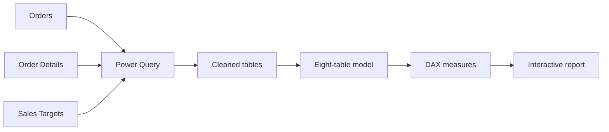

# SALES ANALYTICS / MODEL BLUEPRINT

## 01 — Data architecture

## 02 — Model layers

| Layer | Design responsibility | Review question |
|---|---|---|
| Source | Orders, order details, sales targets | Are source fields understood? |
| Transform | Power Query cleanup and shaping | Are types and keys consistent? |
| Model | Eight-table data model | Do relationships filter correctly? |
| Measure | DAX calculations | Do totals reconcile? |
| Report | Sales, profit, margin and target views | Can users answer business questions? |

## 03 — Visual architecture map

## 04 — KPI catalogue

<table>
<tr><th>MEASURE FAMILY</th><th>BUSINESS QUESTION</th></tr>
<tr><td>💰 Sales</td><td>What is the sales total and how does it trend?</td></tr>
<tr><td>📈 Profit</td><td>Which categories contribute profit?</td></tr>
<tr><td>％ Margin</td><td>How does profit compare with sales?</td></tr>
<tr><td>🎯 Targets</td><td>How does actual sales compare with monthly targets?</td></tr>
<tr><td>🗓️ Time</td><td>How do results change across periods?</td></tr>
</table>

## 05 — Open the engineering package

- [Power BI report](Data%20Transformation%20%26%20Data%20Modeling.pbix)
- [Raw data](Raw%20Data/)
- [Cleaned data](Cleaned%20Data/)
- [Project documentation](Documentation/)

## 06 — Validation gates

- [ ] Reconcile source and transformed row counts.
- [ ] Inspect relationship cardinality and filter direction.
- [ ] Validate DAX totals against source tables.
- [ ] Confirm target-period alignment.
- [ ] Test slicers, cross-filtering and visual interactions.

> The SVG is an overview illustration, not a Power BI screenshot. Validate numerical outputs in the PBIX before presenting them externally.