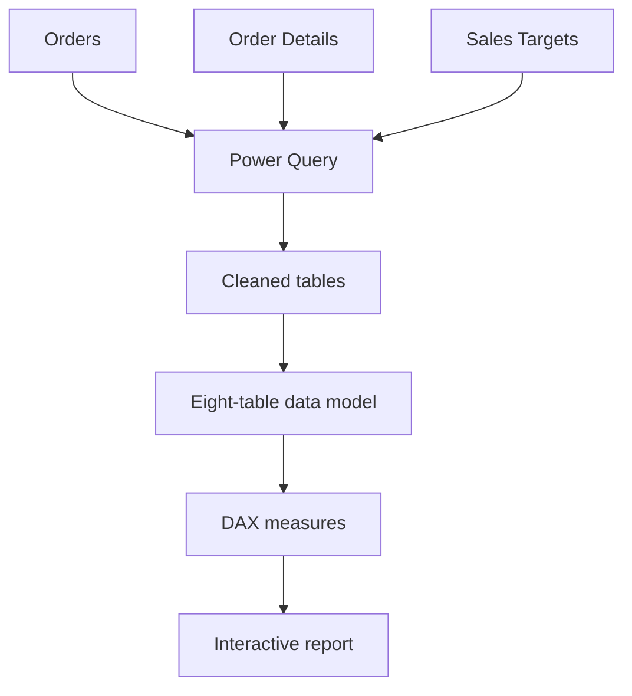

# 🏗️ SALES ANALYTICS — DATA ARCHITECTURE

  

## Architecture schematic

## System layers
| Layer | Responsibility | Review output |
|---|---|---|
| Sources | Orders, order details, sales targets | Three source datasets |
| Transform | Power Query cleanup and shaping | Prepared tables |
| Model | Relationships and DAX | Eight-table model |
| Report | Sales, profit, margin and target views | Interactive PBIX |

## Project overview

## KPI design board
| KPI family | Business question |
|---|---|
| Sales | What is total sales and its trend? |
| Profit | Which categories contribute profit? |
| Margin | How does profit compare with sales? |
| Targets | How does actual sales compare with monthly targets? |
| Time | How do results change across periods? |

## Source package
- [Editable Power BI report](Data%20Transformation%20%26%20Data%20Modeling.pbix)
- [Raw data folder](Raw%20Data/)
- [Cleaned data folder](Cleaned%20Data/)
- [Documentation folder](Documentation/)

## Model acceptance tests
- [ ] Reconcile source and transformed row counts.
- [ ] Inspect relationships and filter direction.
- [ ] Validate DAX totals against source tables.
- [ ] Confirm target-period alignment.
- [ ] Test slicers and visual interactions.

> The SVG is an overview illustration, not a Power BI screenshot. Validate numerical outputs in the PBIX before presenting them externally.