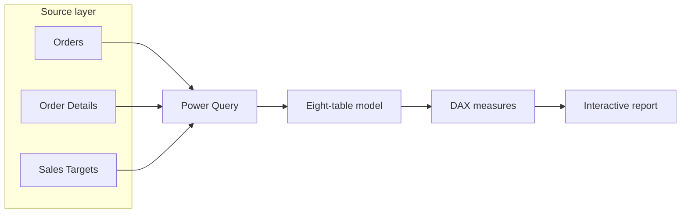

<h1>SALES MODEL / ARCHITECTURE BLUEPRINT</h1>

## Architecture map

## Model specification
| LAYER | RESPONSIBILITY | CONTROL |
|---|---|---|
| Sources | Orders, order details, sales targets | Source completeness |
| Transform | Power Query shaping | Types, keys, nulls |
| Model | Eight-table structure | Cardinality and filter flow |
| Calculation | DAX measures | Reconciliation |
| Presentation | Sales, profit, margin, targets | Interaction tests |

## KPI design catalogue
<table><tr><td><b>💰 SALES</b> How much was sold?</td><td><b>📈 PROFIT</b> Where is profit generated?</td></tr><tr><td><b>％ MARGIN</b> How profitable are sales?</td><td><b>🎯 TARGET</b> How does actual compare?</td></tr></table>

## Model illustration

## Repository components
- [Power BI report](Data%20Transformation%20%26%20Data%20Modeling%20using%20Power%20BI.pbix)
- [Raw data folder](raw-data/)
- [Cleaned data folder](cleaned-data/)
- [Documentation folder](docs/)

## Business recommendations

The documented analysis covers 999 order-detail rows and 343 unique orders from the selected project data. It reports total profit of **-444** and an overall margin of **-0.16%**. Furniture shows a **-3,513** category profit, while Tables shows a **-4,640** sub-category profit and Saree has high sales alongside a loss. These figures are project-dataset results, not current company performance.

1. **Investigate loss-making products first.** Review the cost, discount, freight, return and pricing components behind Tables, Furniture and Saree before recommending price or assortment changes.
2. **Separate sales growth from profitable growth.** Review sales, absolute profit and margin together. High revenue alone should not be treated as strong performance when the related margin is negative.
3. **Prioritise category follow-up.** Electronics is closest to its supplied target at 84.05%, while Clothing has the strongest category margin at 2.47%. Review target gaps alongside profitability rather than setting one uniform action for every category.
4. **Use drill-downs before acting.** Compare category, sub-category, state and month, then verify unusual results against source rows and the Power BI measures.

**Before a business decision:** reconcile the DAX measures, relationship behaviour and target-period alignment in the PBIX. The dataset uses a selected source scope and does not represent a live company; recommendations are analytical follow-ups, not proof of savings or causes. See [Business Analysis](docs/Business_Analysis.md) for the detailed figures.

## Model review gates
- [ ] Reconcile source and transformed row counts.
- [ ] Validate relationship cardinality and direction.
- [ ] Recalculate DAX totals against source tables.
- [ ] Check target-period alignment.
- [ ] Test slicers and cross-filtering.

> The SVG is a conceptual overview, not a Power BI screenshot. Validate report values inside the PBIX before external presentation.