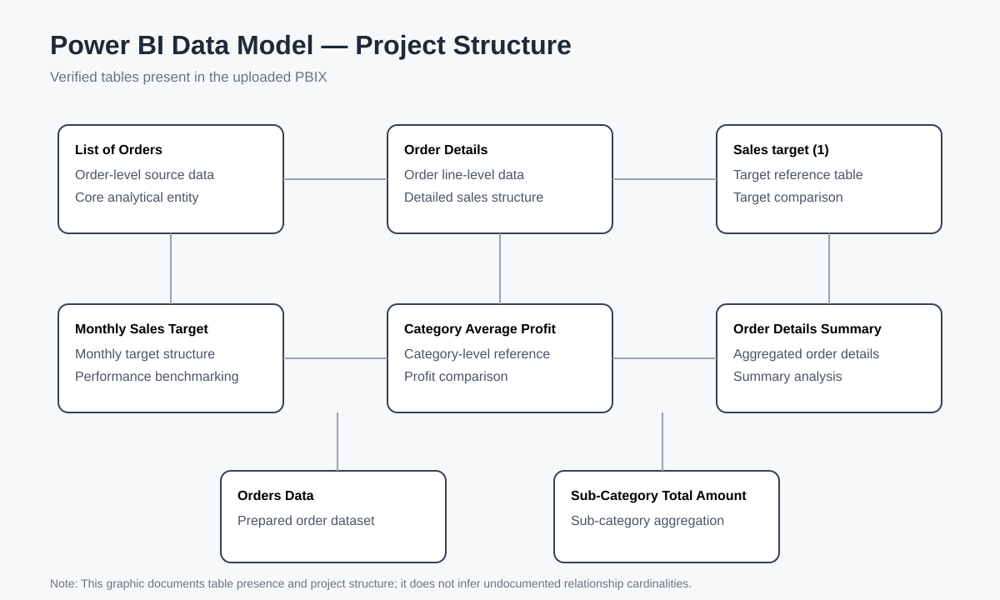
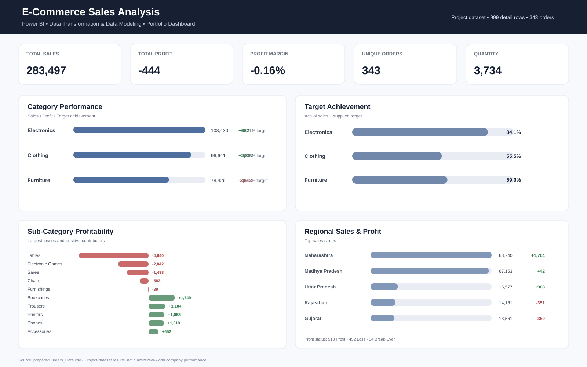

# Data Transformation & Data Modeling Using Power BI

<p align="center">
  
</p>

<p align="center">
  
  
  
  
</p>

## 1. Project Overview

This project demonstrates an end-to-end data preparation and modeling workflow using Microsoft Power BI.

The project uses sales, order-detail and sales-target data to demonstrate data cleaning, transformation, data modeling, KPI analysis and business reporting.

The objective is to convert raw source files into structured analytical tables and explore sales performance, profitability and target achievement.

## 2. Business Problem

A business wants to understand its sales performance, profitability and target achievement across product categories, sub-categories and locations.

The available source files require preparation and transformation before they can be used for meaningful reporting.

This project demonstrates how Power Query and Power BI can prepare related datasets and organise them for business analysis.

## 3. Project Objectives

- Inspect and understand multiple raw source files.
- Clean and transform data using Power Query.
- Handle data types, missing values and inconsistent fields.
- Combine order-level and order-detail data using Order ID.
- Create supporting analytical tables.
- Document an eight-table Power BI data model.
- Analyse sales, profit, profit margin and target achievement.
- Identify category and sub-category performance patterns.
- Present analytical results through report visuals.

## 4. Source Dataset

The project uses three original CSV files.

| Source file | Description |
|---|---|
| [List of Orders](raw-data/List_of_Orders.csv) | Order-level information |
| [Order Details](raw-data/Order_Details.csv) | Product, quantity, sales and profit information |
| [Sales Target](raw-data/Sales_Target.csv) | Monthly category sales targets |

### Data preparation summary

| Data item | Records |
|---|---:|
| List of Orders — source | 560 |
| List of Orders — selected for transformation | 500 |
| Cleaned List of Orders | 500 |
| Order Details — source | 999 |
| Sales Target | 36 |
| Orders Data after merge | 999 |
| Unique Order IDs in merged data | 343 |

The transformation follows the documented assignment scope, which selects the first 500 rows from the List of Orders source.

## 5. Data Cleaning and Transformation

The project uses Power Query to prepare the source data.

### Main transformations

- Prepared Order Date as a date field.
- Converted Amount and Target into suitable numeric fields.
- Standardised customer-name formatting.
- Created a combined City and State location field.
- Created Profit Margin using Profit divided by Amount.
- Created Profit Status categories: Profit, Loss and Break-Even.
- Merged order-level and order-detail data using Order ID.
- Checked missing and duplicate data.
- Created supporting summary datasets.

### Cleaned output files

| File | Purpose |
|---|---|
| [Cleaned List of Orders](cleaned-data/Cleaned_List_of_Orders.csv) | Prepared order-level data |
| [Cleaned Order Details](cleaned-data/Cleaned_Order_Details.csv) | Prepared order-detail data |
| [Cleaned Sales Target](cleaned-data/Cleaned_Sales_Target.csv) | Prepared monthly target data |
| [Orders Data](cleaned-data/Orders_Data.csv) | Merged analytical dataset |

## 6. Power BI Data Model

The project documents eight analytical tables:

1. Sales target (1)
2. Order Details (1)
3. List of Orders
4. Orders Data
5. Category Average Profit
6. Monthly Sales Target
7. Order Details Summary
8. Sub-Category Total Amount



The model supports analysis of order-level data, product categories, sub-categories, monthly targets and profitability.

For detailed table information, see [Data Model Documentation](docs/Data_Model_Documentation.md).

## 7. Business Analysis and Key Findings

The following figures are documented from the prepared project dataset.

### KPI summary

| KPI | Result |
|---|---:|
| Order-detail rows | 999 |
| Unique orders | 343 |
| Total sales | 283,497 |
| Total quantity | 3,734 |
| Total profit | -444 |
| Overall profit margin | -0.16% |
| Profit rows | 513 |
| Loss rows | 452 |
| Break-even rows | 34 |

### Category performance

| Category | Sales | Profit | Target achievement |
|---|---:|---:|---:|
| Electronics | 108,430 | 682 | 84.05% |
| Clothing | 96,641 | 2,387 | 55.54% |
| Furniture | 78,426 | -3,513 | 59.01% |

### Important observations

- Electronics recorded the highest sales at 108,430.
- Clothing generated the highest category profit at 2,387.
- Furniture recorded a loss of 3,513.
- Electronics achieved approximately 84.05% of its sales target.
- Clothing achieved 55.54% of its sales target.
- Tables recorded the largest sub-category loss at -4,640.
- Saree recorded high sales of 42,375 but a loss of 1,438.

**Business interpretation:** High sales do not always mean high profitability. The dataset shows why sales, profit and profit margin should be reviewed together.

These are descriptive findings from the project dataset, not verified results from a live business.

For detailed analysis, see [Business Analysis Documentation](docs/Business_Analysis.md).

## 8. Dashboard Preview



*This SVG is a static dashboard layout preview, not an actual screenshot exported from Power BI Desktop. Open the PBIX file to review the Power BI report.*

**[Open Power BI Report](Data%20Transformation%20%26%20Data%20Modeling%20using%20Power%20BI.pbix)**

## 9. Analytical Areas

| Analysis area | Purpose |
|---|---|
| Sales Performance | Review total sales and quantity |
| Profitability | Compare profit and profit margin |
| Category Analysis | Compare Electronics, Clothing and Furniture |
| Sub-Category Analysis | Identify high-sales and loss-making sub-categories |
| Target Achievement | Compare actual sales with monthly targets |
| Regional Analysis | Explore sales and profit by state |
| Profit Status | Compare profit, loss and break-even records |

## 10. Tools and Technologies

| Tool | Application |
|---|---|
| Microsoft Power BI | Data modeling and reporting |
| Power Query | Data cleaning and transformation |
| DAX | Analytical calculations and measures |
| CSV | Source and prepared datasets |

## 11. Project Documentation

The `docs` folder contains supporting documentation.

| Document | Description |
|---|---|
| [Data Cleaning Report](docs/DATA_CLEANING_REPORT.md) | Source data, transformations and validation |
| [Data Model Documentation](docs/Data_Model_Documentation.md) | Eight-table model and analytical structure |
| [Business Analysis](docs/Business_Analysis.md) | KPIs, category performance and findings |

## 12. How to Run the Project

**Prerequisite:** Microsoft Power BI Desktop.

1. Clone or download this repository.
2. Review the CSV files in the `raw-data` folder.
3. Review the cleaned CSV files in the `cleaned-data` folder.
4. Open the PBIX file in Power BI Desktop.
5. Inspect the tables and relationships in Model view.
6. Review the Power Query transformations.
7. Explore the report visuals and available filters.
8. Compare report measures with the business analysis documentation.

## 13. Project Structure

```text
Data-Transformation-Data-Modeling-using-Power-BI/
│
├── Data Transformation & Data Modeling using Power BI.pbix
│
├── raw-data/
│   ├── List_of_Orders.csv
│   ├── Order_Details.csv
│   └── Sales_Target.csv
│
├── cleaned-data/
│   ├── Cleaned_List_of_Orders.csv
│   ├── Cleaned_Order_Details.csv
│   ├── Cleaned_Sales_Target.csv
│   └── Orders_Data.csv
│
├── docs/
│   ├── DATA_CLEANING_REPORT.md
│   ├── Data_Model_Documentation.md
│   └── Business_Analysis.md
│
├── images/
│   ├── data-model-architecture.svg
│   └── Business_Dashboard.svg
│
└── README.md
```

## 14. Scope and Limitations

- The transformation uses the first 500 rows of the List of Orders source file, as documented in the project.
- Results depend on the supplied datasets and the documented model and calculation definitions.
- The overall profit is negative in the prepared dataset.
- Category and sub-category comparisons are descriptive and do not establish causes of profit or loss.
- The dashboard SVG is a conceptual layout preview, not a Power BI screenshot.
- The project is an analytical demonstration and should not be interpreted as current real-company performance.

## 15. Author

**Shanmukh Koyya**

- **GitHub:** [shanmukhkoyya](https://github.com/shanmukhkoyya)
- **LinkedIn:** [linkedin.com/in/shanmukh-koyya](https://www.linkedin.com/in/shanmukh-koyya/)
- **Email:** [shanmukhkoyya1234@gmail.com](mailto:shanmukhkoyya1234@gmail.com)