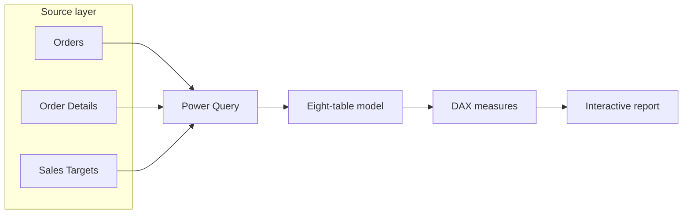

<h1>SALES MODEL / ARCHITECTURE BLUEPRINT</h1>

## Architecture map

## Model specification
| LAYER | RESPONSIBILITY | CONTROL |
|---|---|---|
| Sources | Orders, order details, sales targets | Source completeness |
| Transform | Power Query shaping | Types, keys, nulls |
| Model | Eight-table structure | Cardinality and filter flow |
| Calculation | DAX measures | Reconciliation |
| Presentation | Sales, profit, margin, targets | Interaction tests |

## KPI design catalogue
<table><tr><td><b>💰 SALES</b> How much was sold?</td><td><b>📈 PROFIT</b> Where is profit generated?</td></tr><tr><td><b>％ MARGIN</b> How profitable are sales?</td><td><b>🎯 TARGET</b> How does actual compare?</td></tr></table>

## Model illustration

## Repository components
- [Power BI report](Data%20Transformation%20%26%20Data%20Modeling.pbix)
- [Raw data folder](Raw%20Data/)
- [Cleaned data folder](Cleaned%20Data/)
- [Documentation](Documentation/)

## Model review gates
- [ ] Reconcile source and transformed row counts.
- [ ] Validate relationship cardinality and direction.
- [ ] Recalculate DAX totals against source tables.
- [ ] Check target-period alignment.
- [ ] Test slicers and cross-filtering.

> The SVG is a conceptual overview, not a Power BI screenshot. Validate report values inside the PBIX before external presentation.