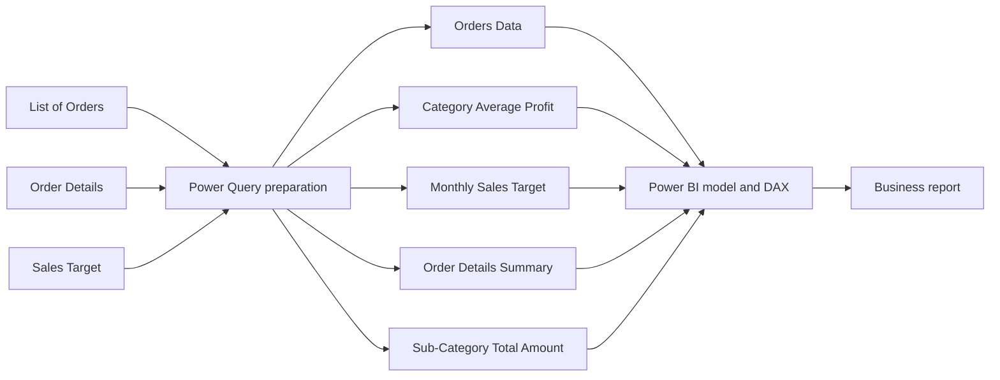
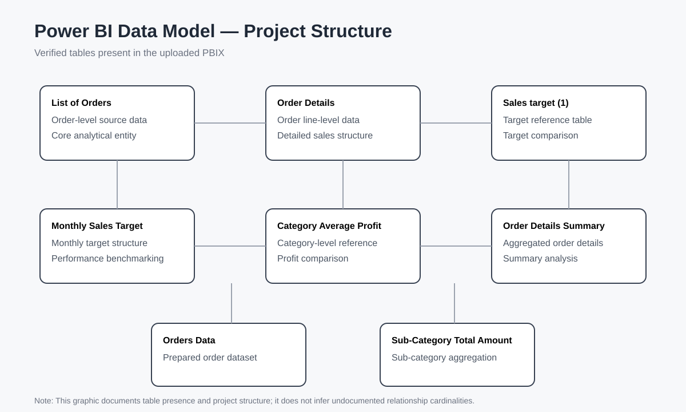
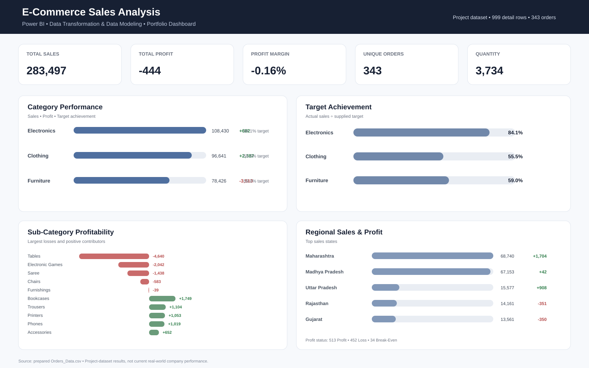

# SALES ANALYTICS MODEL
### Architecture blueprint · Power Query → Power BI → DAX

  
  
  

## 01 — System objective

Prepare order, order-detail and sales-target data so that sales, profit, margin and target achievement can be evaluated together—not as isolated totals.

## 02 — Source-to-model architecture

The repository documents eight analytical tables: Sales target, Order Details, List of Orders, Orders Data, Category Average Profit, Monthly Sales Target, Order Details Summary and Sub-Category Total Amount.

## 03 — Data lineage register

| Source file | Prepared output | Grain / role |
|---|---|---|
| [List of Orders](raw-data/List_of_Orders.csv) | [Cleaned List of Orders](cleaned-data/Cleaned_List_of_Orders.csv) | Order-level attributes |
| [Order Details](raw-data/Order_Details.csv) | [Cleaned Order Details](cleaned-data/Cleaned_Order_Details.csv) | Product, quantity, sales and profit |
| [Sales Target](raw-data/Sales_Target.csv) | [Cleaned Sales Target](cleaned-data/Cleaned_Sales_Target.csv) | Monthly category targets |
| Combined prepared data | [Orders Data](cleaned-data/Orders_Data.csv) | Merged analytical output |

## 04 — Model build metrics

| Input / KPI | Documented result |
|---|---:|
| Source order rows | 560 |
| Order rows selected for transformation | 500 |
| Order-detail rows | 999 |
| Sales-target rows | 36 |
| Unique orders in merged data | 343 |
| Total sales | 283,497 |
| Total profit | -444 |
| Overall profit margin | -0.16% |

**Selection rule:** The transformation intentionally selects the first 500 rows from the source List of Orders file.

## 05 — Transformation layer

Power Query preparation includes:
- Date and numeric type handling.
- Customer-name standardisation.
- Combined City–State field.
- Profit-margin and profit-status calculations.
- Order ID merge.
- Missing-value and duplicate checks.

## 06 — Business output

| Category | Sales | Profit | Target achievement |
|---|---:|---:|---:|
| Electronics | 108,430 | 682 | 84.05% |
| Clothing | 96,641 | 2,387 | 55.54% |
| Furniture | 78,426 | -3,513 | 59.01% |

**Readout:** Electronics has the highest sales, while Clothing has the highest category profit in this prepared dataset. Furniture records a loss. Tables sub-category records -4,640 profit; Saree records -1,438 profit despite 42,375 sales.

## 07 — Visual design references

These SVGs are static architecture/layout illustrations, not screenshots exported from Power BI Desktop. The editable report is the PBIX file.

**[Open the Power BI report](Data%20Transformation%20%26%20Data%20Modeling%20using%20Power%20BI.pbix)**

## 08 — Engineering documentation

| Document | Review focus |
|---|---|
| [Data Cleaning Report](docs/DATA_CLEANING_REPORT.md) | Preparation decisions |
| [Data Model Documentation](docs/Data_Model_Documentation.md) | Table-level model explanation |
| [Business Analysis](docs/Business_Analysis.md) | KPI and category findings |

## 09 — Reproduction protocol

1. Review the three files in `raw-data/`.
2. Compare each prepared CSV in `cleaned-data/`.
3. Open the PBIX in Microsoft Power BI Desktop.
4. Inspect Power Query steps, model relationships, measures and filters.
5. Reconcile report outputs with the documented figures.

<b>Interpretation and validation limits</b>

This is an assignment dataset, not a live-company data feed. The 500-row selection is an intentional project rule. Category comparisons are descriptive and do not explain the causes of profit or loss. Inspect the PBIX model and calculations before treating the report as independently validated.

---

**Author:** Shanmukh Koyya · [GitHub](https://github.com/shanmukhkoyya) · [LinkedIn](https://www.linkedin.com/in/shanmukh-koyya/) · [Email](mailto:shanmukhkoyya1234@gmail.com)